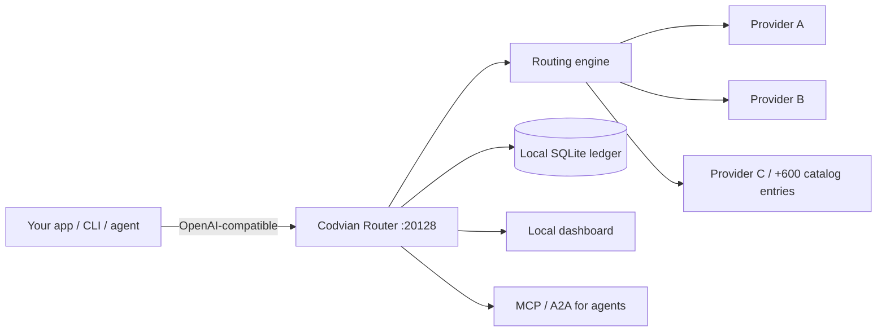

<div align="center">

# Codvian Router

**One API key. Every provider. Your machine.**

[](https://go.dev)
[](LICENSE)
[](docs/ARCHITECTURE.md)

A local-first, open-source LLM router. Point your app at one
OpenAI-compatible base URL, plug in your providers once with your own
keys, and stop thinking about which model is up, which is cheapest, or
what to do when one goes down.

</div>

> **Status: pre-release, local-first AI gateway.** It builds, its test
> suite passes, and it routes real OpenAI-compatible traffic to providers
> you add with your own API keys. It is not a published release yet, and
> settings that were never honoured answer an honest
> `501 feature_unavailable` instead of pretending (see
> [Feature status](#feature-status)).

**Contents** ·
[What this is](#what-this-is) ·
[Why people use it](#why-people-use-it) ·
[Features](#feature-overview) ·
[Architecture](#architecture) ·
[Routing](#routing-engine) ·
[Providers](#provider-catalog) ·
[Auth](#authentication-and-oauth) ·
[API](#api-compatibility) ·
[Multimodal](#multimodal) ·
[Compression](#compression-and-context) ·
[MCP & A2A](#mcp-and-a2a) ·
[Security](#security-and-guardrails) ·
[Billing](#billing-budgets-and-quotas) ·
[Cache](#cache-and-performance) ·
[Observability](#observability) ·
[Dashboard](#dashboard) ·
[Install](#installation) ·
[Quick start](#quick-start) ·
[Configuration](#configuration) ·
[Provider setup](#provider-setup-examples) ·
[CLI](#cli-commands) ·
[Docker](#docker-and-deployment) ·
[Testing](#testing-and-ci) ·
[Feature status](#feature-status) ·
[Limitations](#known-limitations) ·
[Next steps](#next-steps) ·
[Contributing](#contributing) ·
[License](#license-and-links)

## What this is

Codvian Router is a single Go binary that sits between your applications
and the model providers you already pay for. It speaks the OpenAI API on
the front (`/v1/chat/completions`, `/v1/responses`, `/v1/models`, …), the
Anthropic and Gemini surfaces on the back, and it owns the parts of an AI
gateway that are easy to get wrong: failover, budgets, cost accounting,
caching, guardrails, and the ability to explain why a request went where
it went.

Everything runs on your machine. There is no account, no cloud relay and
no telemetry: the router sends a request only to the provider you chose,
for the request you made. State lives in a local SQLite ledger.

- Repository: `raunakiitp/CodvianRouter`
- Baseline `main`: `a45b4ff` (P1 closure); active branch `p2-implementation`
- Toolchain: Go 1.27.4 (`go` directive `1.26.0`) — builds on Linux, macOS and Windows

## Why people use it

- **One key, one URL.** Your apps talk to the router; the router talks to
  every provider. Swap models without touching your code.
- **Your keys stay yours.** Bring your own provider keys. Nothing leaves
  your machine except the request you made to the provider you chose.
- **Failures don't reach you.** When a provider errors, rate-limits or
  stalls, the router moves to the next one before the error reaches your
  app.
- **Spend what you decide.** Per-key budgets and rolling quotas stop
  requests at the limit, with reservations so parallel requests cannot
  jointly overshoot.
- **Honest by construction.** A route that cannot do what its settings
  imply answers `501`, and a static audit (`scripts/audit-fake.sh`) fails
  the build if a known fake comes back.

## Feature overview

| Area | What you get |
|---|---|
| Protocol front door | OpenAI Chat Completions, Responses, Models, Embeddings, Rerank, Images, Audio (speech + transcription/translation), Video, Music, Search, plus batch and files surfaces |
| Back-end wires | Anthropic Messages, Gemini, Vertex, Bedrock, Cohere, and any custom OpenAI-compatible provider |
| Routing | 40 strategies (cost, latency, priority, weighted, P2C, quota-aware, LKGP, SLA-aware, …), nested combos and auto-router variants — all selectable via config |
| Resilience | Failover chains, hedging, health checks, cooldowns, circuit breaking, per-key/per-IP rate limits, fault injection for tests |
| Money | Local ledger with cost per request, reservations + settlement, per-key calendar budgets, rolling 5-hour budgets, quota pools |
| Cache | Exact-match and semantic caching with tenant-scoped keys |
| Context | Prompt compression (lite → ultra) and tool-output compression with fidelity checks |
| Guardrails | PII detection/redaction, prompt-injection checks, secret redaction, SSRF-safe fetch |
| Agents | MCP server (32 tools; stdio + SSE + Streamable HTTP), A2A tasks with streaming and owner scoping |
| Ops | Local dashboard, `/healthz` + `/readyz`, digest-pinned Docker images, SBOM and vulnerability scanning in CI |

## Architecture



One process, one binary. A request is authenticated, matched against the
guard table, normalized into an internal request, routed by the selected
strategy over the candidate chain, executed against a provider, and
streamed back in the client's wire format. Every attempt — success,
error, retry, cooldown, cache hit, compression saving, cost — is written
to the ledger, which is what the dashboard and the cost APIs read.

More detail: [docs/ARCHITECTURE.md](docs/ARCHITECTURE.md).

## Routing engine

**40 routing strategies**, all registered in `internal/strategy` and all
selectable through config (`routing.global_strategy`):

| Group | Strategies |
|---|---|
| Cost | `cheapest`, `cost-optimized`, `budget-aware`, `quota-weighted` |
| Speed | `fastest`, `latency-aware`, `sla-aware`, `headroom` |
| Reliability | `most-reliable`, `priority`, `weighted`, `round-robin`, `p2c`, `least-used`, `lkgp` |
| Shape / state | `context-optimized`, `cache-optimized`, `reset-aware`, `reset-window`, `expiry-first`, `sticky`, `random`, `strict-random` |
| Composite | `auto`, `combo`, `fusion`, `pipeline`, `jev`, `nadir`, plus the auto-router variants |

- **Combos** chain strategies (e.g. cheapest first, then fastest on
  failure) and are validated as a graph, not a list.
- **Auto-router** picks the model from cost, context and capability
  signals instead of taking the model id literally.
- **Decision telemetry**: every attempt records which candidates were
  considered and why the others were excluded (cooldown, capability,
  budget, quota), so a routing decision can be explained after the fact.

Routing behaviour is pinned by tests across `internal/router`,
`internal/autorouter` and `internal/strategy` (see
[Testing and CI](#testing-and-ci)).

## Provider catalog

The catalog is data, and it is explicit about what each entry can do:

| Metric | Count (audit 2026-11-21; A1 base-URL batches 1-17, 2026-11-27) |
|---|---|
| Active catalog entries | **607** (7 retired — cheaperinference by owner decision plus the Item-6 anyscale/kluster shutdown retirements, 2026-11-27) |
| With a base URL the router can call | **474** (460 routable + 14 template-only) |
| Metadata-only (no base URL) | **120** |
| Docs-verified | 172 |
| By category | api-key 473 · oauth 31 · web-cookie 37 · search 21 · local 18 · audio 12 · no-auth 10 · cloud-agent 3 · upstream-proxy 2 |

The ten no-auth entries carry their connection mechanisms in
`internal/noauth` — keyless endpoints with the provider's own
documented per-IP limits enforced locally (AI Horde's anonymous key
`0000000000` with its documented 5/second and 300/minute chat-submit
limits; uncloseai's key-free endpoints under its ToS IP throttling),
and CLI-owned auth bridges (`auggie`, `codex app-server`, `devin acp`,
`mcode`, `zcode`) that spawn the provider CLI and never see its
credentials. Three web-only surfaces (DuckDuckGo AI Chat, Cloudflare's
LLM Playground, veoaifree-web) have no documented anonymous endpoint
and stay metadata-only.

A catalog entry is a starting point, **not a promise**: nothing routes
until you add the provider with your own key, and the router tests that
key against the provider when you add it. Web-session-cookie providers
are catalogued and connectable only through the ToS risk-acknowledgement
gate ([ToS-grey providers](#tos-grey-providers-and-the-risk-acknowledgement-gate)).
The OAuth-category entries
are classified honestly (see
[Authentication and OAuth](#authentication-and-oauth)), and the numbers
above are pinned by tests (`TestCatalogExecutableMatrixCounts`,
`TestCategoryOAuthInventoryPinsTheTruth`).

### ToS-grey providers and the risk-acknowledgement gate

Some catalog entries are marked ToS-grey: connecting one means handing
over your own web-session cookie or subscription login for that
provider. The provider's terms of service may forbid this kind of use.
Because of that, the router does not connect a ToS-grey provider
silently. Adding the provider, loading it from config and sending it a
request all go through a gate that refuses until you have explicitly
acknowledged the risk for that provider — in the dashboard
(Providers — risk acknowledgement) or by
`POST /api/providers/{id}/risk-acknowledgement`. The acknowledgement is
stored locally with your other config; it is not sent anywhere.

What the acknowledgement does **not** do: it is not permission from the
provider, and it does not make the connection safe. The provider may
still suspend or ban the connected account at any time, and you — the
operator — remain fully responsible for how that account is used. The
gate exists so this kind of connection can only happen knowingly: none
of these paths run until you have said, explicitly and for that
provider, that you accept the risk.

Evidence: [docs/catalog-audit-2026-11-21.md](docs/catalog-audit-2026-11-21.md),
[docs/PROVIDER_AUTH_MATRIX.md](docs/PROVIDER_AUTH_MATRIX.md).

## Authentication and OAuth

Two identities, kept strictly apart: **your clients** authenticate to the
gateway, and **the router** authenticates to providers.

- **Gateway auth** — gateway keys (with scopes, IP allowlists, expiry),
  plus OAuth/JWT clients for the gateway itself. One canonical
  `principalFor` resolver extracts the credential once with documented
  precedence (Bearer → `X-Api-Key` → `X-Goog-Api-Key` → `?key=` on
  `/v1beta/` only), so conflicting headers can never mix identities, and
  scope checks fail closed.
- **Provider credentials** — stored locally and encrypted at rest; the
  router mints and re-mints short-lived tokens where the provider
  requires it.

Provider account login, classified honestly:

| Provider | Mechanism | Status |
|---|---|---|
| OpenRouter | OAuth PKCE, in-router (`codvian-router provider login openrouter`, `POST /admin/provider/login`); the exchanged key is live-tested and stored encrypted; further logins join the provider's key pool | Implemented |
| Azure OpenAI | Microsoft Entra ID client credentials (`{tenant_id, client_id, client_secret}`); the router mints the Bearer token and re-mints it on expiry | Implemented |
| Claude | Docs-verified endpoint with an `oauth-pkce` exchange description: you obtain the subscription token (`claude setup-token` or a PKCE client) and the router dials with it — **the router does not perform the login** | Supported with external login |
| GitHub Copilot, ClinePass | Base URL known; no auth surface declared | Partially documented |
| 13 `CategoryOAuth` entries (codex, kimi-coding, kilocode, cline, openference, qoder, devin-cli, amazon-q, kiro, cursor, ghe-copilot, gitlab-duo, renderhour) | Docs-verified base URL from the provider's own docs; the login itself is not performed in-router | Partially documented |
| Remaining 15 `CategoryOAuth` entries | Metadata stubs (no base URL, no endpoints) | Metadata only |

Interactive subscription sign-in (device code / browser cookie) is **not
built**; those entries are not usable through a login. Details:
[docs/PROVIDER_LOGIN.md](docs/PROVIDER_LOGIN.md).

Provider-side flows implemented in-router: OpenRouter PKCE (above),
Azure Entra ID client credentials, Vertex service-account JWT and Bedrock
SigV4. All are deterministic-mock-tested; only the flows you configure
with real keys touch the network.

## API compatibility

**350 registered routes** (183 GET · 118 POST · 22 DELETE · 22 PATCH ·
5 PUT), tiered as 11 local-only, 58 always-protected and 281 management.
The full list with request/response shapes is generated into
[docs/API_REFERENCE.md](docs/API_REFERENCE.md) (regeneration is
reproducible and checked).

| Surface | Status |
|---|---|
| OpenAI Chat Completions (streaming, tools, JSON schema) | Implemented, tested |
| OpenAI Responses | Implemented, tested |
| OpenAI Models / Embeddings / Rerank | Implemented, tested |
| Images (generations/edits), Audio (speech, transcription, translation) | Implemented; upstream tested against mocks |
| Video, Music, Search, OCR passthrough | Implemented; upstream tested against mocks |
| Anthropic Messages, Gemini `generateContent` | Implemented, tested (including streamed tool-call reassembly) |
| Structured output | Tool schemas (`parametersJsonSchema`) mapped and tested; response-side `responseSchema`/`responseMimeType` is **rejected with the field named** rather than silently dropped |
| Usage accounting, cancellation, retry semantics, error mapping | Implemented and tested per surface |

**63 routes answer `501 feature_unavailable` on purpose** — settings that
were stored but never applied (budget templates, management tokens, key
pools, global IP filters, feature flags, CORS, stickiness, log
destinations, and others). Each answer names the route to use instead
when one exists. The list is `internal/server/unavailable_routes.go`.

## Multimodal

A modality is only listed as supported where the request layer, the
router's endpoint projection and a provider wire exist together:

| Modality / operation | State |
|---|---|
| Text in/out (chat, responses, tools, structured tool schemas) | Implemented, tested |
| Embeddings, rerank | Implemented, tested |
| Image generation/edit | Implemented, mock-tested upstream |
| Audio in (transcription, translation), audio out (speech) | Implemented, mock-tested upstream |
| Video, music, OCR, search | Implemented, mock-tested upstream |
| Mixed-modality requests | Passed through per provider wire; per-provider capability is what the catalog declares |

The endpoint→surface projection matrix (chat/messages/responses/gemini →
chat; embeddings; rerank; images; audio ×3; search; ocr; video → videos;
music) is pinned by tests, and an unknown endpoint kind fails loudly
instead of degrading to chat.

## Compression and context

- Prompt compression from **lite to ultra**, plus **tool-output
  compression**, with fidelity verification and a lossless fallback.
- A worker pool exists for compression workloads with a deliberate
  contract: it serves **background/evaluation work only** — request-path
  parking is forbidden by design, so hot-path compression latency is
  measured serially and honestly.
- Token counting and budget estimation feed the budget and cost paths.
- Compression savings are recorded per request in the ledger and
  surfaced in the dashboard.

## MCP and A2A

**MCP: 32 tools** (3 built-in + 29 registered) over three transports:

| Transport | Endpoint | Notes |
|---|---|---|
| stdio | MCP mode | for local agents |
| SSE | `GET /api/mcp/sse` + `POST` | session-bound |
| Streamable HTTP | `POST/GET/DELETE /api/mcp/stream` | full session lifecycle |

Security model: gateway-key auth in a **disjoint `mcp:` scope namespace**
(an `admin`, `chat` or `*` scope key is refused — no privilege
escalation), per-key and per-IP rate limits that answer `429` with
`Retry-After`, bounded crypto-random sessions (64 per transport, 16 per
key, 5-minute idle eviction), session isolation, and fail-closed
transport toggles that default to **off** (`503` until enabled). Covered
by 27 dedicated transport tests plus the A2A suite.

**A2A**: agent card discovery, task creation and persistence, status
transitions, cancellation, streaming, owner-scoped task visibility, and
background panic containment — a panicking worker is counted in
`codvian_router_panics_total` and logged redacted, never silently
swallowed.

Agent setup is one command: `codvian-router setup codevn` (the CLI also
supports `claude` and `continue`).

## Security and guardrails

- **Identity** — single canonical principal resolution, documented
  precedence, conflicting credentials resolved safely, scope checks
  fail-closed, per-key IP allowlists.
- **Tenant isolation** — owner-scoped ledger reads; batch, file and
  webhook ownership checks; IDOR tests on task and resource paths.
- **SSRF** — the fetch surface resolves and validates targets (including
  DNS-rebinding protection) before any request leaves the machine.
- **Redaction** — secrets are redacted from logs and error paths, with
  fuzz targets (`FuzzRedactPEMWholeBlock`, `FuzzStreamRedactorChunkSplits`)
  running in CI.
- **Prompt/PII guardrails** — prompt-injection checks, PII detection and
  redaction, content filtering.
- **Limits** — request body size limits, per-key and per-IP rate limits,
  and disk quotas for the files API.
- **Supply chain** — dependency vulnerability scanning (`govulncheck`),
  SBOM generation, gitleaks secret scanning and a repository secret
  scanner in CI; no competitor references in tracked content
  (`scripts/check-naming.sh`).

## Billing, budgets and quotas

- Every request is costed and written to a local SQLite ledger (prompt,
  completion, cached, reasoning and cache-write tokens; provider/model/key
  attribution; errors; latency).
- **Reserve before send, settle after**: a request reserves its estimated
  spend, and the reservation is released exactly once per request —
  idempotent by construction, so retries and re-opened streams cannot
  double-charge.
- **Per-key budgets** (calendar daily/weekly/monthly) and **rolling
  5-hour budgets**, with strict/cheapest over-budget behaviour, plus
  **quota pools** for keys that share a cap.
- Unpriced models fail closed rather than being billed as free.
- Async spend writers batch writes with bounded retry and honest
  drop-after-retry accounting.
- A forecast endpoint projects exhaustion from real 1h/24h spend and
  request windows, kept consistent at exact-millisecond boundaries by a
  dedicated regression test.

## Cache and performance

- **Exact-match cache** and **semantic cache** with tenant-scoped keys.
- Request deduplication for identical concurrent work.
- Connection pooling and bounded concurrency, with backpressure rather
  than unbounded queues.

Measured 2026-11-18 on a shared VM (1.5 shared vCPU) — a floor, not a
boast; method and history in [docs/BENCHMARK.md](docs/BENCHMARK.md):

| Metric | Measured | Target | Verdict |
|---|---|---|---|
| Added latency (p50) | 0.851 / 0.777 ms | < 0.5 ms | Not yet met |
| Throughput (32 concurrent) | 1,273 / 1,174 req/s | > 3,000 req/s | Not yet met |
| Idle memory | 42.1 MiB | < 70 MiB | Met |
| Ready to serve | ~435 / 565 ms | < 10 s | Met |

An automatic regression gate (`cmd/bench-compare`) compares a fresh run
against a committed baseline and reports an honest `SKIP` when no
comparable baseline exists.

## Observability

- **Structured logs** (text or JSON) with request ids; provider, model,
  key, outcome and latency on every request line.
- **Metrics** covering requests, tokens, cost, cache hits, compression
  savings, cooldowns, quota events, panics and rate-limit decisions.
- **Tracing is honest about itself**: the default build compiles tracing
  as a zero-cost no-op (pinned by tests — spans never record and no
  fabricated `traceparent` is emitted); the recording tracer is behind an
  explicit `-tags otel` build with its own tests.
- **Decision visibility**: candidate selection and exclusion reasons are
  recorded so a failed or surprising routing decision can be explained.
- Everything is local; no external collector is required or contacted.

## Dashboard

A local dashboard at `http://127.0.0.1:20128/dashboard` covers providers,
models, keys, usage and forecasts, budgets, logs, health, resilience
state, webhooks, verifications, MCP/A2A controls and routing
configuration. Every view is wired to a live endpoint — a static audit
(`scripts/audit-fake.sh`) fails the build if a control without a working
backend is reintroduced. The UI uses native interactive elements with
`:focus-visible` focus styling, modal focus trapping and
Escape-to-close.

> The latest UI has **not** been manually reviewed by the owner; treat the
> dashboard as functionally wired and test-covered, not visually
> acceptance-tested.

## Installation

```bash
# From source (Go 1.27.4 toolchain)
git clone https://github.com/raunakiitp/CodvianRouter.git
cd CodvianRouter
go build -o codvian-router ./cmd/codvian-router
```

Docker images build from the repository's Dockerfiles, with every base
image pinned by registry digest. Published binaries and an npm package do
not exist yet. Full guide: [docs/INSTALL.md](docs/INSTALL.md).

## Quick start

```bash
./codvian-router init          # creates config + a gateway key (shown once — save it)
./codvian-router serve         # http://127.0.0.1:20128
```

Then list models through the router:

```bash
curl http://127.0.0.1:20128/v1/models \
  -H "Authorization: Bearer ***"
```

Prefer a guided first run? `./codvian-router init --wizard` walks through
provider → key → model → a real test call, every step skippable. Verify a
running gateway with `./codvian-router doctor`.

## Configuration

Config is a single JSON file (default under your user profile; override
with `--config`). The pieces you will actually touch:

```jsonc
{
  "routing": {
    "global_strategy": "cheapest",   // any of the 40 strategies
    "combos": { /* named strategy chains */ }
  },
  "gateway_keys": [ /* keys with scopes, IP allowlists, budgets */ ],
  "providers": [ /* each entry: provider id, base URL, your key */ ]
}
```

Settings that exist but are not honoured answer `501` instead of silently
doing nothing. Route-by-route reference:
[docs/API_REFERENCE.md](docs/API_REFERENCE.md).

## Provider setup examples

```bash
# OpenAI-compatible provider with your own key
./codvian-router providers add --id openai --key sk-…

# OpenRouter account login (OAuth PKCE) — key live-tested, stored encrypted
./codvian-router provider login openrouter

# Azure OpenAI via Microsoft Entra ID client credentials
#   store {"tenant_id": "...", "client_id": "...", "client_secret": "..."} as the key

# Claude: obtain the subscription token yourself, then let the router dial with it
claude setup-token
```

Browse what the catalog offers with `./codvian-router catalog`.

## CLI commands

27 subcommands, including `serve`, `init`, `run`, `doctor`, `tray`,
`restart`, `stop`, `status`, `provider`/`providers`, `catalog`, `key`,
`eval`, `setup` and `release`, plus maintenance helpers.
`./codvian-router --help` lists them all with usage; the guided wizard and
`doctor` are the two commands worth knowing first.

## Docker and deployment

- `Dockerfile` and `Dockerfile.release` pin every base image by `@sha256`
  digest (enforced by `scripts/ci.sh`).
- The container healthcheck hits `GET /healthz` (unauthenticated, 2s
  timeout); `/readyz` performs a dependency check so orchestration can
  tell "process up" from "ready to serve".
- Graceful shutdown drains in-flight work; `restart`/`tray` manage a
  supervised child process.
- System-service installation (systemd / launchd / Windows service) is
  **not** supported yet and answers `501`.

## Testing and CI

- **55 packages with tests** (of 57 packages), **5,039 test functions**,
  **2 fuzz targets**; `go test ./...` is green on Windows and Linux.
- Real-provider tests are separated from mock upstreams: provider wires
  (Anthropic, Gemini, Vertex, Bedrock, Cohere, audio, images, video,
  music) are tested against deterministic mock upstreams, and this README
  says so rather than implying live verification.
- GitHub Actions runs on every push: `ci` (build, vet, test, gofmt, route
  guards, secrets), `windows`, `secret-scan` (gitleaks), `fuzz` (30 s per
  target), `redis` (live-Redis cache test), `playwright` and
  `client-smoke` (browser/CLI smoke), `bench-smoke`, `sbom-and-vuln`,
  `supply-chain`.
- Local gates: `scripts/ci.sh` runs the same battery on your machine.

## Feature status

| Status | What it covers |
|---|---|
| Implemented and verified (tests + local run) | OpenAI-compatible chat, models, embeddings, rerank, Responses; the 40 routing strategies and combos; failover, hedging, health checks, cooldowns; exact and semantic cache; compression; ledger, cost tracking, reservations, per-key budgets and quota pools; guardrails; gateway keys and OAuth/JWT clients; `/admin/restart` (real relaunch); `/admin/update` (release check only); SSRF-safe `/v1/web/fetch`; OpenRouter OAuth PKCE and Azure Entra ID login (deterministic mock auth-host tests — see the auth matrix for evidence tiers) |
| Implemented, mock-tested upstream | Provider-specific wires (Anthropic, Gemini, Vertex, Bedrock, Cohere), audio, images, video, music, OCR and search passthroughs |
| Supported with external login | Claude — you obtain the subscription token; the router dials with it and does not perform the login |
| Metadata only | 120 catalog entries without a base URL, web-cookie entries, and subscription-OAuth entries that would need an unbuilt sign-in flow |
| Unsupported or deferred (`501 feature_unavailable`) | System service install, dynamic plugin loading, and 63 dashboard-era routes whose settings were never applied |

`scripts/audit-fake.sh` enforces this contract statically: a canned
success, a fixed metric or an undocumented `501` fails the audit.

## Known limitations

- **WS3 batch re-queue is intentionally not implemented.** Interrupted
  batches are marked failed on recovery and deliberately not re-run; safe
  automatic re-queue needs durable per-row served/failed accounting to
  avoid duplicate provider charges. Recovery is client-side: read
  `output_file_id` (succeeded) + `error_file_id` (failed), correct the
  input, submit a new batch.
- Added latency and throughput targets are **not met** (see
  [Cache and performance](#cache-and-performance)).
- 218 catalog entries are metadata only (down from 231 across the A1 base-URL batches
  A1 base-URL batch); interactive subscription sign-in
  (device code / browser cookie) is not built.
- Dynamic (loadable) plugins are not supported; built-in capabilities are
  compiled in.
- The latest dashboard UI has not had a manual owner review.
- No published release, binary or npm package yet.

## Next steps

Proposed, pending owner approval — not commitments:

1. Close the latency/throughput gap on a dedicated benchmark rig rather
   than a shared VM.
2. Design durable per-row batch accounting, the prerequisite for any safe
   re-queue.
3. Owner review of the dashboard UI.

## Contributing

Issues and pull requests are welcome. The bar is high on purpose: every
change needs a test that fails without it, and the full gate must stay
green. Check [Known limitations](#known-limitations) before adding a
feature — if it is listed there, that is the queue.

## License and links

MIT — © Codvian. See [LICENSE](LICENSE).

| Doc | What it is |
|---|---|
| [docs/INSTALL.md](docs/INSTALL.md) | Install, verify, troubleshoot |
| [docs/ARCHITECTURE.md](docs/ARCHITECTURE.md) | How the router is put together |
| [docs/API_REFERENCE.md](docs/API_REFERENCE.md) | Every route, generated from the guard table |
| [docs/PROVIDER_LOGIN.md](docs/PROVIDER_LOGIN.md) | Provider account login flows |
| [docs/PROVIDER_AUTH_MATRIX.md](docs/PROVIDER_AUTH_MATRIX.md) | Per-provider auth evidence tiers |
| [docs/BENCHMARK.md](docs/BENCHMARK.md) | How speed is measured, and every result |
| [docs/RELEASE-CHECKLIST.md](docs/RELEASE-CHECKLIST.md) | What "ready to release" means here |
| [CHANGELOG.md](CHANGELOG.md) | What changed, release by release |

---

[Back to top](#codvian-router)
