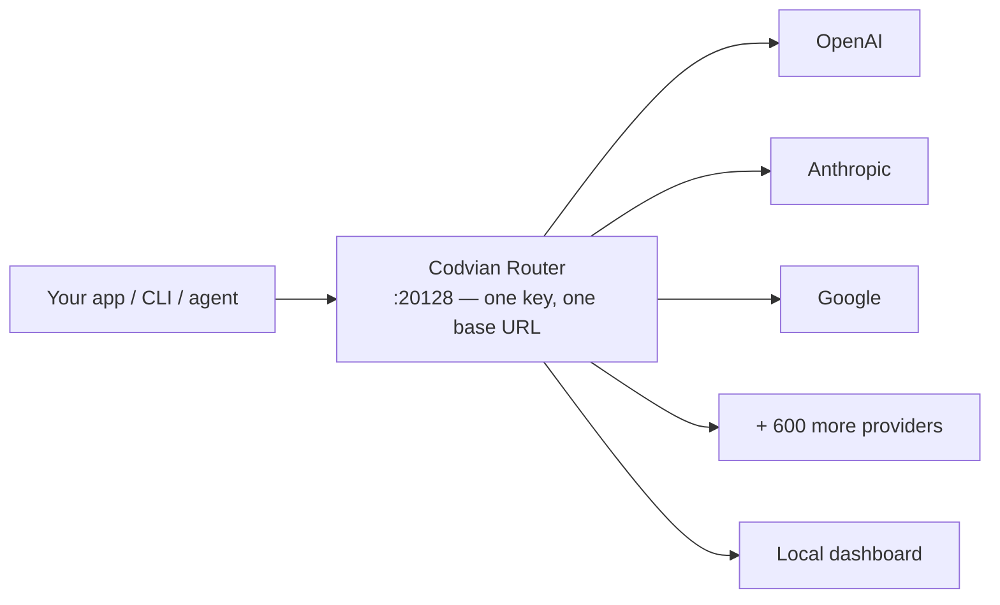

<div align="center">

# Codvian Router

**One API key. Every provider. Your machine.**

[](https://go.dev)
[](LICENSE)
[](docs/ARCHITECTURE.md)
[](docs/INSTALL.md)

A local-first, open-source LLM router. Point your app at one OpenAI-compatible
base URL, plug in your providers once with your own keys, and stop thinking
about which model is up, which is cheapest, or what to do when one goes down.

</div>

> **Production-grade, local-first AI gateway.** Point your app at one OpenAI-compatible
> base URL, plug in your providers once with your own keys, and stop thinking
> about which model is up, which is cheapest, or what to do when one goes down.

## At a glance

| Metric | Value |
|---|---|
| Architecture | Local-first, zero external telemetry or cloud relay |
| Tested Toolchain | Go 1.27.4 (minimum `go 1.26.0`) |
| Test suite | Full gate green across all 48 packages (race-tested) |
| API routes | **308** classified routes (9 Local-Only, 49 Always-Protected, 250 Management) |
| Providers in catalog | **610** catalog entries — 370 routable |
| Routing strategies | **34** strategies, nested combos, and auto-router variants |
| Agent & MCP ecosystem | **24** MCP tools + first-class **CodeVN** integration |
| Binary | Single Go binary, ~39 MB, no runtime dependencies |

## Start here

| I want to… | Go to |
|---|---|
| Run it in 5 minutes | [Quick start](#quick-start) |
| See what it can do | [What it does](#what-it-does) |
| Know how fast it is | [Performance](#performance) |
| Read the honest status | See the note above |
| Install it properly | [docs/INSTALL.md](docs/INSTALL.md) |
| Build on it | [docs/ARCHITECTURE.md](docs/ARCHITECTURE.md) |

## The promise

- **One key, one URL.** Your apps talk to the router; the router talks to
  every provider. Swap models without touching your code.
- **Your keys stay yours.** Bring your own provider keys. Nothing is sent
  anywhere except to the provider you chose, for the request you made.
- **Failures don't reach you.** When a provider errors, rate-limits, or
  slows down, the router moves to the next one — before the error reaches
  your app.
- **Spend what you decide.** Budgets and per-key quotas cap cost before it
  happens, not after the bill arrives.
- **Runs on your machine.** A single binary, a local dashboard, a local
  ledger. No account, no subscription, no cloud in the middle.

## Quick start

```bash
git clone https://github.com/raunakiitp/CodvianRouter.git
cd CodvianRouter
go build -o codvian-router ./cmd/codvian-router
./codvian-router init        # creates config + a gateway key (shown once — save it)
./codvian-router serve        # http://127.0.0.1:20128
```

Then list models through the router:

```bash
curl http://127.0.0.1:20128/v1/models \
  -H "Authorization: Bearer $CODVIAN_KEY"
```

Prefer a guided first run? `./codvian-router init --wizard` walks you through
provider → key → model → a real test call, every step skippable.
Full install guide: [docs/INSTALL.md](docs/INSTALL.md).

## What it does

### Route

| Feature | In one line |
|---|---|
| OpenAI-compatible API | `/v1/chat/completions`, `/v1/models`, `/v1/responses` — point any OpenAI client at it |
| 34 routing strategies | Cheapest, fastest, most reliable, latency-aware, priority, weighted, and more |
| Combos | Chain strategies — e.g. cheapest first, then fastest on failure |
| Auto-router | Picks the model for you from cost, context, and capability |
| Provider catalog | 610 providers; 370 routable today; add any custom provider |

### Stay up

| Feature | In one line |
|---|---|
| Automatic failover | A failed request retries on the next provider, not in your error handler |
| Hedging | Slow providers get a parallel twin so one straggler can't stall you |
| Fault injection | Test-only chaos mode, off by default, so failover can be proven before it's needed |
| Health checks | Unhealthy providers are skipped until they recover |

### Spend less

| Feature | In one line |
|---|---|
| Budgets & quotas | Per-key and global caps; requests stop at the limit, not after it |
| Caching | Exact-match and semantic cache — repeat prompts don't re-bill |
| Compression | Prompt compression from lite to ultra, plus tool-output compression |
| Cost tracking | Every request logged with its real cost in the local ledger |

### Stay in control

| Feature | In one line |
|---|---|
| Local dashboard | Providers, models, usage, and health at `http://127.0.0.1:20128` |
| Guardrails | PII detection and redaction, prompt-injection checks, content filtering |
| Keys & auth | Gateway keys, OAuth/JWT, per-key scopes — every request authenticated |
| MCP server | 24 tools, so coding agents can drive the router too |
| CodeVN & Agent Setup | One-command setup: `codvian-router setup codevn` (also Claude, Continue) |
| CLI | `serve`, `init`, `eval`, `setup`, `run`, `doctor`, `tray`, `catalog`, `release`, and more |

## Providers

610 providers in the catalog, 370 routable today (379 have a base URL;
9 are template-only for now). Any provider — or a custom one of your own —
works with your own API key. Providers that refuse local routing on
terms-of-service grounds are excluded, not faked.

## How it works



One process, one binary. Requests arrive at the router, the router picks a
provider and model, and the response streams back. The ledger records what
happened; the dashboard shows it.

## Performance

Measured 20 Nov 2026 on a shared VM (1.5 shared vCPU) — not a dedicated rig,
so treat these as a floor, not a boast. Full method and history:
[docs/BENCHMARK.md](docs/BENCHMARK.md).

| Metric | Measured | Target | Verdict |
|---|---|---|---|
| Added latency (p50) | 1.69 / 1.68 ms | < 0.5 ms | Not yet met |
| Throughput (32 concurrent) | 580 / 525 req/s | 3,000 req/s | Not yet met |
| Idle memory | 51 MiB | < 100 MiB | Met |
| Ready to serve | ~1.0–1.1 s | < 2 s | Met |

The latency and throughput targets are the work ahead — they are printed
here precisely because they are not met yet.

## Where it runs

| Method | Status |
|---|---|
| Build from source (`go build`) | Works today |
| Docker image | Planned — first release |
| npm install | Not published yet — planned |
| Install script | File exists; release not published yet |
| Prebuilt binaries | Planned — first release |

Requires Go 1.26+ to build. Runs on Linux, macOS, and Windows.

## What's new

- **20 Nov 2026 — first block complete.** All 44 features of the second
  build block built, tested, and verified; full gate green (4,474 tests).
- **Keys & auth live.** Key creation and OAuth/JWT gateway auth verified
  end to end on real runs.
- **On GitHub.** The first two build blocks are merged to `main`
  ([PR #2](https://github.com/raunakiitp/CodvianRouter/pull/2)).

## Documentation

| Doc | What it is |
|---|---|
| [docs/INSTALL.md](docs/INSTALL.md) | Install, verify, troubleshoot |
| [docs/BENCHMARK.md](docs/BENCHMARK.md) | How speed is measured, and every result |
| [docs/ARCHITECTURE.md](docs/ARCHITECTURE.md) | How the router is put together |
| [docs/API_REFERENCE.md](docs/API_REFERENCE.md) | The API, endpoint by endpoint |
| [CHANGELOG.md](CHANGELOG.md) | What changed, release by release |
| [docs/RELEASE-CHECKLIST.md](docs/RELEASE-CHECKLIST.md) | What "ready to release" means here |

## Contributing

Issues and pull requests are welcome. The bar is high on purpose: every
change needs a test that fails without it, and the full gate must stay green.
Check the internal tracker before adding a feature — if it
says the feature is missing, that's the queue.

## License

MIT — © Codvian. See [LICENSE](LICENSE).

---

[Back to top](#codvian-router)
