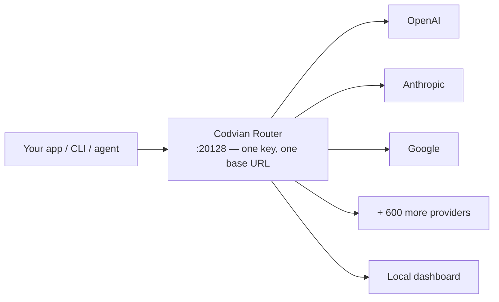

<div align="center">

# Codvian Router

**One API key. Every provider. Your machine.**

[](https://go.dev)
[](LICENSE)
[](docs/ARCHITECTURE.md)
[](docs/INSTALL.md)

A local-first, open-source LLM router. Point your app at one OpenAI-compatible
base URL, plug in your providers once with your own keys, and stop thinking
about which model is up, which is cheapest, or what to do when one goes down.

</div>

> **Status: pre-release, local-first AI gateway.** It builds, its test suite
> passes, and it routes real OpenAI-compatible traffic to providers you add
> with your own API keys. It is not a published release yet, and several
> dashboard-era settings routes are honestly marked unavailable (see
> [Feature status](#feature-status)).

## At a glance

| Metric | Value |
|---|---|
| Architecture | Local-first, zero external telemetry or cloud relay |
| Tested toolchain | Go 1.27.4 (minimum `go 1.26.0`) |
| Test suite | `go test ./...` passes on all 55 packages (Windows, 2026-11-21) |
| API routes | **349** classified routes (11 Local-Only, 49 Always-Protected, 289 Management), of which **63** answer `501 feature_unavailable` on purpose |
| Providers in catalog | **610** catalog entries; 379 have a base URL the router can call with your key, 231 have none (metadata only) |
| Routing strategies | **41** strategies, nested combos, and auto-router variants |
| Agent & MCP ecosystem | **32** MCP tools over HTTP/SSE/stdio + **CodeVN** setup |
| Binary | Single Go binary, no runtime dependencies |

## Start here

| I want to… | Go to |
|---|---|
| Run it in 5 minutes | [Quick start](#quick-start) |
| See what it can do | [What it does](#what-it-does) |
| Know how fast it is | [Performance](#performance) |
| Read the honest status | [Feature status](#feature-status) |
| Install it properly | [docs/INSTALL.md](docs/INSTALL.md) |
| Build on it | [docs/ARCHITECTURE.md](docs/ARCHITECTURE.md) |

## The promise

- **One key, one URL.** Your apps talk to the router; the router talks to
  every provider. Swap models without touching your code.
- **Your keys stay yours.** Bring your own provider keys. Nothing is sent
  anywhere except to the provider you chose, for the request you made.
- **Failures don't reach you.** When a provider errors, rate-limits, or
  slows down, the router moves to the next one — before the error reaches
  your app.
- **Spend what you decide.** Budgets and per-key quotas cap cost before it
  happens, not after the bill arrives.
- **Runs on your machine.** A single binary, a local dashboard, a local
  ledger. No account, no subscription, no cloud in the middle.

## Quick start

```bash
git clone https://github.com/raunakiitp/CodvianRouter.git
cd CodvianRouter
go build -o codvian-router ./cmd/codvian-router
./codvian-router init        # creates config + a gateway key (shown once — save it)
./codvian-router serve        # http://127.0.0.1:20128
```

Then list models through the router:

```bash
curl http://127.0.0.1:20128/v1/models \
  -H "Authorization: Bearer $CODVIAN_KEY"
```

Prefer a guided first run? `./codvian-router init --wizard` walks you through
provider → key → model → a real test call, every step skippable.
Full install guide: [docs/INSTALL.md](docs/INSTALL.md).

## What it does

### Route

| Feature | In one line |
|---|---|
| OpenAI-compatible API | `/v1/chat/completions`, `/v1/models`, `/v1/responses` — point any OpenAI client at it |
| 41 routing strategies | Cheapest, fastest, most reliable, latency-aware, priority, weighted, and more |
| Combos | Chain strategies — e.g. cheapest first, then fastest on failure |
| Auto-router | Picks the model for you from cost, context, and capability |
| Provider catalog | 610 entries; 379 have a callable base URL; add any custom OpenAI-compatible provider |

### Stay up

| Feature | In one line |
|---|---|
| Automatic failover | A failed request retries on the next provider, not in your error handler |
| Hedging | Slow providers get a parallel twin so one straggler can't stall you |
| Fault injection | Test-only chaos mode, off by default, so failover can be proven before it's needed |
| Health checks | Unhealthy providers are skipped until they recover |

### Spend less

| Feature | In one line |
|---|---|
| Budgets & quotas | Per-key calendar budgets (`/api/usage/budget`), rolling 5-hour budgets (`/dashboard/key-budgets`), quota pools; requests stop at the limit |
| Caching | Exact-match and semantic cache — repeat prompts don't re-bill |
| Compression | Prompt compression from lite to ultra, plus tool-output compression |
| Cost tracking | Every request logged with its real cost in the local ledger |

### Stay in control

| Feature | In one line |
|---|---|
| Local dashboard | Providers, models, usage, and health at `http://127.0.0.1:20128` |
| Guardrails | PII detection and redaction, prompt-injection checks, content filtering |
| Keys & auth | Gateway keys, OAuth/JWT clients for the gateway, per-key scopes and IP lists — every request authenticated. Provider account login: OpenRouter OAuth PKCE (`provider login openrouter`); Azure OpenAI via Microsoft Entra ID client credentials. Subscription/cookie sign-in remains unsupported |
| MCP server | 32 tools, so coding agents can drive the router too |
| CodeVN & Agent Setup | One-command setup: `codvian-router setup codevn` (also Claude, Continue) |
| CLI | `serve`, `init`, `eval`, `setup`, `run`, `doctor`, `tray`, `catalog`, `release`, and more |

## Providers

The catalog has 610 entries (catalog audit 2026-11-21,
[docs/catalog-audit-2026-11-21.md](docs/catalog-audit-2026-11-21.md)):
379 have a callable base URL, and 231 have none (metadata only). A catalog entry is a starting point,
not a promise: an entry is routed only after you add it with your own key,
and the router tests that key against the provider when you add it.
Web-session-cookie providers are catalogued but refused as routing
targets. Two credential exchanges are implemented (Phase 1): OpenRouter
account login via the official OAuth PKCE flow (`codvian-router provider
login openrouter` or `POST /admin/provider/login` — the exchanged API key
is live-tested and stored encrypted, and further logins join the same
provider's key pool as additional accounts), and Azure OpenAI with
Microsoft Entra ID client credentials (store `{tenant_id, client_id,
client_secret}` JSON as the key; the router mints the Bearer token and
re-mints it on expiry). The interactive subscription sign-in flows
(device code / browser cookie) are still not built, so those entries are
not usable through a login. Nothing is faked. See
[docs/PROVIDER_LOGIN.md](docs/PROVIDER_LOGIN.md) and the evidence-tiered
[docs/PROVIDER_AUTH_MATRIX.md](docs/PROVIDER_AUTH_MATRIX.md).

## How it works



One process, one binary. Requests arrive at the router, the router picks a
provider and model, and the response streams back. The ledger records what
happened; the dashboard shows it.

## Performance

Measured 2026-11-18 on a shared VM (1.5 shared vCPU) — not a dedicated rig,
so treat these as a floor, not a boast. Full method and history:
[docs/BENCHMARK.md](docs/BENCHMARK.md).

| Metric | Measured | Target | Verdict |
|---|---|---|---|
| Added latency (p50) | 0.851 / 0.777 ms | < 0.5 ms | Not yet met |
| Throughput (32 concurrent) | 1,273 / 1,174 req/s | > 3,000 req/s | Not yet met |
| Idle memory | 42.1 MiB | < 70 MiB | Met |
| Ready to serve | ~435 / 565 ms | < 10 s | Met |

The latency and throughput targets are the work ahead — they are printed
here precisely because they are not met yet.

## Where it runs

| Method | Status |
|---|---|
| Build from source (`go build`) | Works today |
| Background gateway (`codvian-router restart`, `tray`) | Works today (supervised child process) |
| Docker | `Dockerfile` and `docker-compose.yml` in the repo; no published image yet |
| System service (systemd / launchd / Windows service) | Not supported yet (`POST /admin/service/install` answers 501) |
| npm install | Not published |
| Install script / prebuilt binaries | Files exist; no release published yet |

Requires Go 1.26+ to build. Runs on Linux, macOS, and Windows.

## Feature status

| Status | What it covers |
|---|---|
| Implemented and verified (tests + local run) | OpenAI-compatible chat, models, embeddings, rerank, Responses API; routing strategies and combos; failover, hedging, health checks; exact and semantic cache; compression; ledger, cost tracking, per-key budgets and quota pools; guardrails; gateway keys and OAuth/JWT clients; `/admin/restart` (graceful relaunch); `/admin/update` (release check only); SSRF-safe `/v1/web/fetch`; OpenRouter OAuth PKCE account login and Azure Entra ID client-credentials auth (deterministic mock auth-host/upstream tests — see the auth matrix for evidence tiers) |
| Implemented, not verified against a real provider in this repo's checks | Provider-specific wires (Anthropic, Gemini, Vertex, Bedrock, Cohere), audio, images, video and music passthroughs. They are tested against mock upstreams |
| Metadata only | Catalog entries without a base URL (231), web-cookie entries, and subscription OAuth entries that need an unbuilt sign-in flow |
| Unsupported or deferred (`501 feature_unavailable`) | System service install, dynamic plugin loading, and 61 dashboard settings routes whose values were never applied (budget templates, management tokens, key pools, global IP filter, feature flags, CORS, stickiness, log destinations, and others). Each 501 names the route to use instead when one exists. The full list is `internal/server/unavailable_routes.go` |

`scripts/audit-fake.sh` checks this contract statically and fails if a
known fake (canned success text, fixed metrics, an undocumented 501) comes
back.

## What's new

- **21 Nov 2026 — Phase 0 cleanup.** Removed fabricated endpoints (a canned
  "SystemOne" reply, fixed video "drilldown" metrics, a static voice list),
  fixed a DNS-rebinding hole in `/v1/web/fetch`, made `/admin/restart` a
  real relaunch and `/admin/update` a real release check, and turned 61
  settings routes that stored values nothing read into honest
  `501 feature_unavailable` answers.
- **On GitHub.** The first build blocks are merged to `main`
  ([PR #2](https://github.com/raunakiitp/CodvianRouter/pull/2)).

## Documentation

| Doc | What it is |
|---|---|
| [docs/INSTALL.md](docs/INSTALL.md) | Install, verify, troubleshoot |
| [docs/BENCHMARK.md](docs/BENCHMARK.md) | How speed is measured, and every result |
| [docs/ARCHITECTURE.md](docs/ARCHITECTURE.md) | How the router is put together |
| [docs/API_REFERENCE.md](docs/API_REFERENCE.md) | The API, endpoint by endpoint |
| [CHANGELOG.md](CHANGELOG.md) | What changed, release by release |
| [docs/RELEASE-CHECKLIST.md](docs/RELEASE-CHECKLIST.md) | What "ready to release" means here |

## Contributing

Issues and pull requests are welcome. The bar is high on purpose: every
change needs a test that fails without it, and the full gate must stay green.
Check the internal tracker before adding a feature — if it
says the feature is missing, that's the queue.

## License

MIT — © Codvian. See [LICENSE](LICENSE).

---

[Back to top](#codvian-router)
